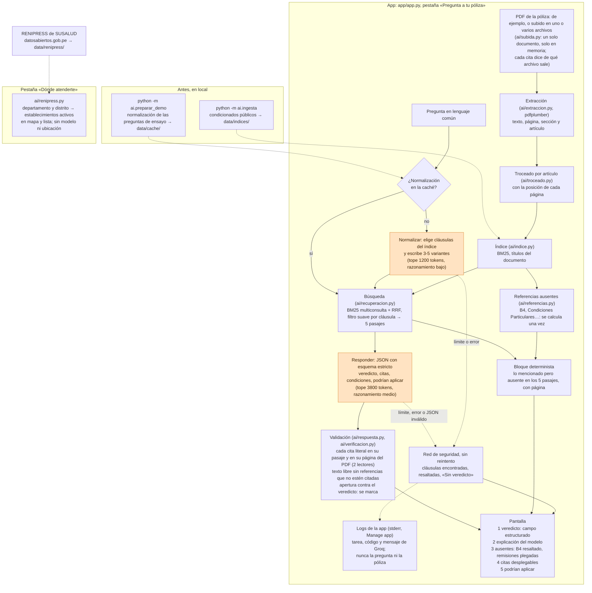

# Arquitectura

Una consulta, de la pregunta a la pantalla, y la pestaña del mapa. Lo que hace el modelo
está en naranja; todo lo demás es código, incluida la verificación de cada cita contra el
PDF. La app corre en Streamlit Community Cloud ([queqbre.streamlit.app](https://queqbre.streamlit.app/)).
Versión en imagen: [`arquitectura.png`](arquitectura.png).

**Qué sale de la app.** Solo la pregunta y los 5 pasajes recuperados (no el PDF entero),
hacia Groq (`openai/gpt-oss-120b`, retención cero de datos activada en la cuenta). Una
pregunta de ensayo hace una llamada (la normalización está en la caché); una nueva, dos.
Si una llamada falla, la app no reintenta: muestra la red de seguridad y deja en sus logs
una línea con la tarea, el código y el mensaje de Groq, sin la pregunta ni la póliza.

**La pestaña del mapa** no toca el modelo ni la ubicación de la persona: filtra por
departamento y distrito el registro de establecimientos activos de RENIPRESS (SUSALUD,
datos abiertos), preparado una vez con `python -m ai.renipress` y versionado en
`data/renipress/`.

**Qué no depende del modelo.** La extracción con página y artículo, la búsqueda, la
verificación de cada cita contra el PDF, el bloque de lo mencionado pero ausente y el
veredicto que se muestra (es el campo estructurado, no el texto). Lo que sí es del modelo:
elegir las cláusulas y las variantes de búsqueda, y redactar la respuesta y su conclusión,
que la verificación no garantiza (ver Limitaciones en el README).

## Capturas

Tomadas el 2026-11-09 de la app desplegada ([queqbre.streamlit.app](https://queqbre.streamlit.app/)),
con respuestas en vivo de Groq (`openai/gpt-oss-120b`), con
`python pruebas/capturas.py --url https://queqbre.streamlit.app --espera 45`. El script deja pasar
el límite por minuto entre las dos preguntas y se detiene sin guardar si una respuesta sale sin
veredicto o sin el bloque de B4: el primer intento de P02 cayó en la red de seguridad (respuesta
sin el formato esperado) y se descartó; estas son del segundo.

1. Inicio: los tres pasos de cómo funciona; arriba, subir el PDF de la póliza (uno o varios
   archivos); debajo, en letra chica, los condicionados de ejemplo; la pregunta con "Una
   pregunta a la vez." y los dos ejemplos de Tarapoto, que solo aparecen con la póliza de Chubb.

   

2. La radiografía al llegar a Lima (P02): "Cubre con límites" arriba, B4 resaltado con su
   página, las remisiones plegadas y tres citas. Esta vez la explicación salió corta y el
   modelo puso la exclusión de exámenes de rutina entre las que aplican, aunque la radiografía
   la indicó un médico: es el hueco de la conclusión que se describe en Limitaciones.

   

3. La torcedura en Tarapoto (P01): "Cubre con límites", B4 y una cita desplegada con su texto
   literal, su página y la verificación contra el PDF.

   

4. Dónde atenderte, en Tarapoto: los establecimientos activos de RENIPRESS en el mapa y en
   la lista, con el aviso de que no son la red de la aseguradora. No usa el modelo.

   
