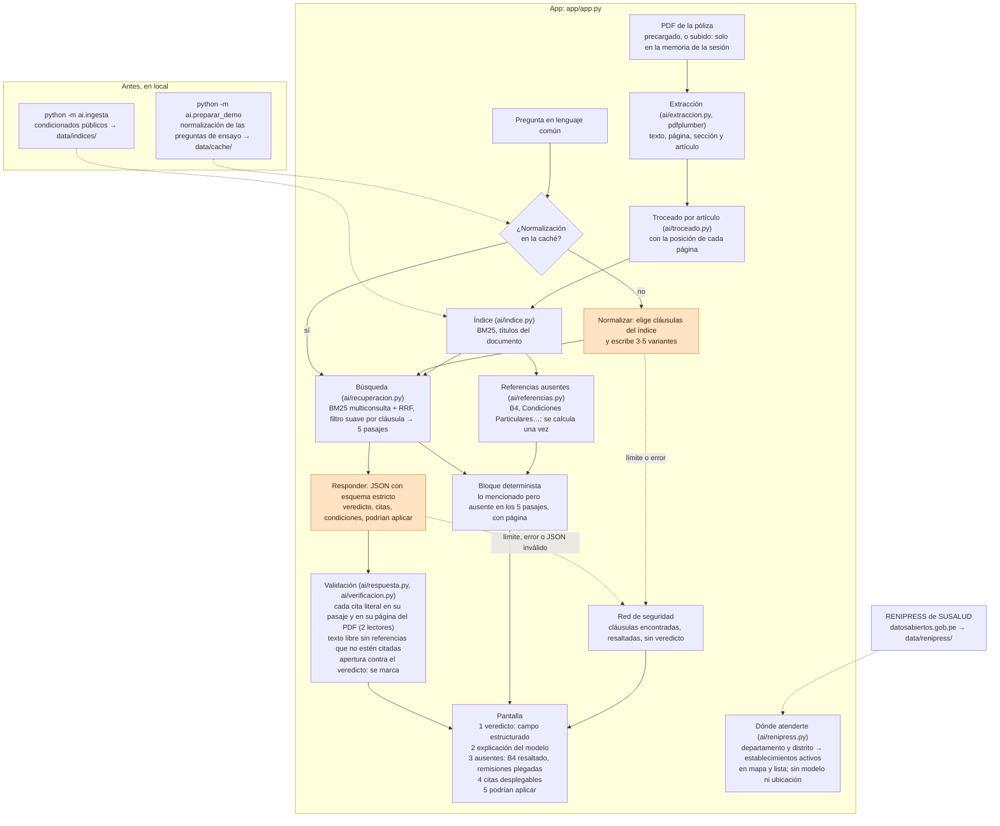
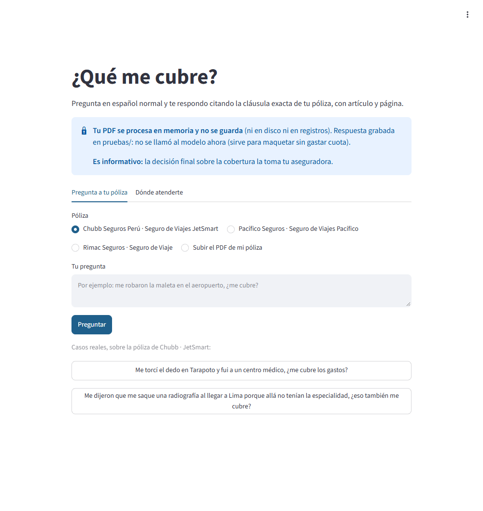
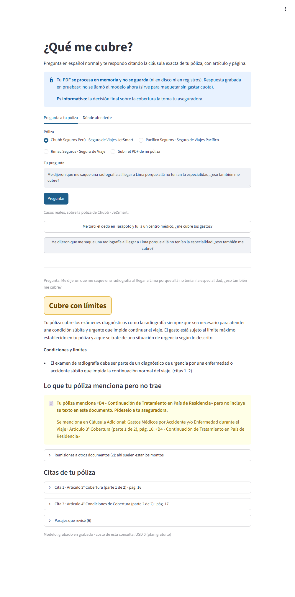
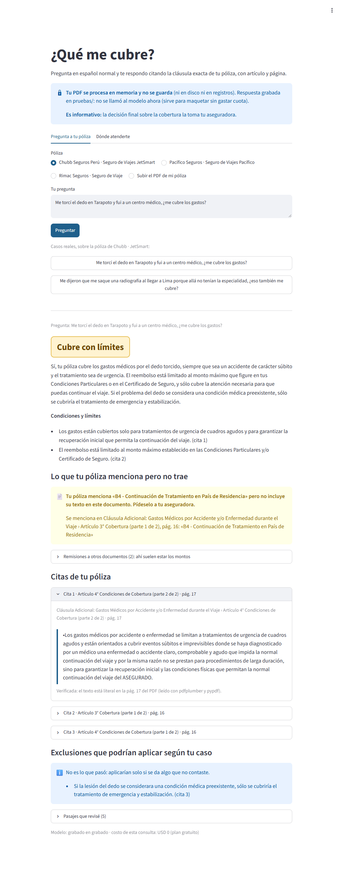
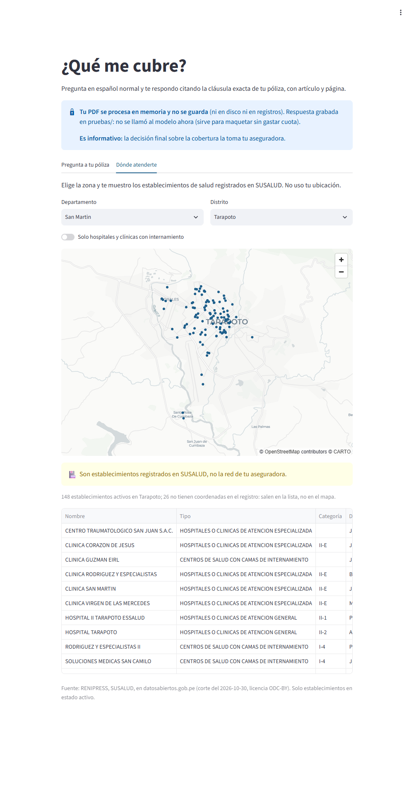

# Arquitectura

Una consulta, de la pregunta a la pantalla. Lo que hace el modelo está en naranja; todo lo
demás es código, incluida la verificación de cada cita contra el PDF. La app corre en
Streamlit Community Cloud. Versión en imagen: [`arquitectura.png`](arquitectura.png).

**Qué sale de la app.** Solo la pregunta y los 5 pasajes recuperados (no el PDF entero),
hacia Groq (`openai/gpt-oss-120b`, retención cero de datos activada en la cuenta). Una
pregunta de ensayo hace una llamada (la normalización está en la caché); una nueva, dos.

**Qué no depende del modelo.** La extracción con página y artículo, la búsqueda, la
verificación de cada cita contra el PDF, el bloque de lo mencionado pero ausente y el
veredicto que se muestra (es el campo estructurado, no el texto). Lo que sí es del modelo:
elegir las cláusulas y las variantes de búsqueda, y redactar la respuesta y su conclusión,
que la verificación no garantiza (ver Limitaciones en el README).

## Capturas

Tomadas con `python pruebas/capturas.py` sobre la app en local con el proveedor de maqueta
(`QMC_PROVEEDOR=grabado`): la respuesta del modelo es la que ya dio para esa pregunta en
`pruebas/salidas/`, y todo lo demás (búsqueda, verificación de citas, bloque de ausentes,
interfaz) corrió de verdad. Por eso el aviso de arriba dice "Respuesta grabada" en vez de
Groq. Se reemplazan por capturas de la app desplegada cuando se pruebe en vivo.

1. Inicio: póliza, pregunta y los dos casos reales de Tarapoto como botones.

   

2. La radiografía al llegar a Lima (P02): veredicto arriba, explicación, B4 resaltado con su
   página y las remisiones plegadas.

   

3. La torcedura en Tarapoto (P01): una cita desplegada con su texto literal y página, y la
   preexistencia en "exclusiones que podrían aplicar según tu caso". El texto grabado abre
   con "Sí,": quedó marcado y la etiqueta de arriba, "Cubre con límites", es la que manda.

   

4. Dónde atenderte, en Tarapoto: los establecimientos activos de RENIPRESS en el mapa y en
   la lista, con el aviso de que no son la red de la aseguradora. No usa el modelo.

   
